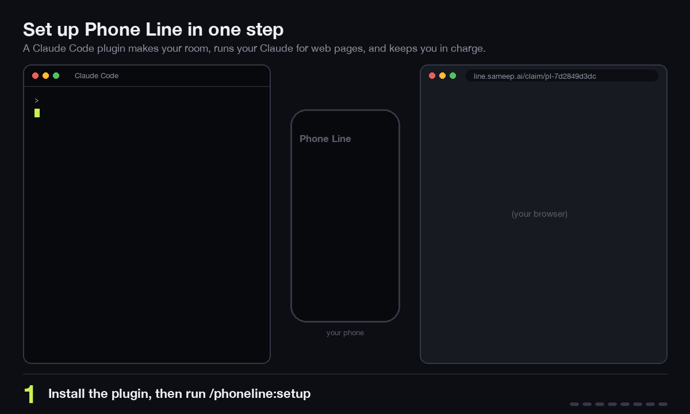

# Phone Line

Let web pages run on **your own Claude**, with you in charge. With Phone Line, a site never holds an API key and never pays for inference: it asks your Claude, on your Mac, and you approve.



## Install

In Claude Code:

```
/plugin marketplace add sameeeeeeep/phoneline
/plugin install phoneline@phoneline
/phoneline:setup
```

`/phoneline:setup` does the rest:

1. **Makes your room** on Phone Line (line.sameep.ai), with this Mac already in it.
2. **Starts the runner**, a small background program with no dependencies, as a login service. It starts when you log in and restarts if it stops.
3. **Opens the claim page.** It shows a 6-digit code. Claim the room only if your terminal shows the same code, and it's yours.

You need Claude Code installed and signed in, Node 18 or later, and macOS for the login service. On a Linux server, the runner runs too: setup prints the command to keep running.

## How it works

- A web page adds one script (`https://line.sameep.ai/kit.js`) and asks to join your room. You approve it once by its code, in your room page or on your phone.
- The page sends jobs, and each job names its app. Your runner decides what that app may use:
  - An app you haven't set up runs on the model only: no files, no shell, no connectors.
  - Tools that only read can be allowed per app.
  - Tools that act (send, write, pay, delete) **ask you first, every time**: a card on your notch (Ask Notch) and in your room, with a 6-digit code the page also shows.
  - Optionally, an app's every job waits for your tap first.
- Each job has a time limit, and each app has a daily cap.
- Every job appears as a live card in your room: what the page asked, what it used, and what you allowed.

The phone is optional. Add your room to its Home Screen if you want taps and notifications away from the Mac.

## Commands

| Command | What it does |
|---|---|
| `/phoneline:setup` | Make your room (or reuse it), start the runner, open the claim page |
| `/phoneline:status` | Your room, its owner, the runner, your apps |
| `/phoneline:apps` | See or change what each app may do: `allow <app> --origin <site> [--tool t] [--act t] [--approve-jobs \| --auto]`, `deny <app>` |
| `/phoneline:uninstall` | Stop the runner (`forget` also deletes this Mac's room login) |

## For page authors

```html
<script src="https://line.sameep.ai/kit.js"></script>
<script>
  const line = new PhoneLine({ room: "<the visitor's room>", name: "My app" });
  await line.connect({ onCode: (code) => showCode(code) });   // first visit: the visitor approves this code
  const r = await line.run({ app: "my-app", prompt: "…", onText: (delta, all) => draw(all) });
</script>
```

## Privacy

- The site only ever gets the answers to its jobs. It never sees your files, your connectors or your other pages' jobs.
- Your room holds the pages you approved and their messages. Its tokens are stored only as hashes.
- The runner logs every job and every tap to `~/.phoneline/log.jsonl` on your Mac.
- `/phoneline:uninstall forget` removes everything on this Mac.

MIT licensed.
